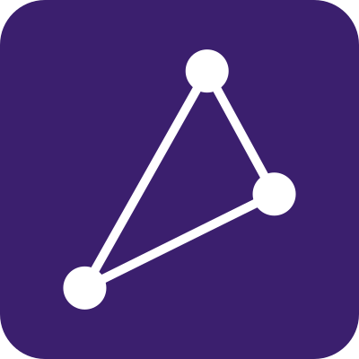

<div align="center">



# PAODO Workspaces CLI

**Manage your PAODO Workspaces app from the terminal, built for coding agents.**

[Website](https://paodo-solution.com/workspaces) ·
[PAODO Workspaces](https://github.com/paodo-solution/PAODO-Workspaces) ·
[Install](#install) ·
[Usage](#usage)

</div>

---

PAODO Workspaces turns coding agents into controlled, callable AI services. Each workspace is an
isolated container running its own coding agent, reachable through chat, an API or MCP.

The CLI lets your coding agent build and run the agents of your PAODO app. It creates workspaces and
gives each one what its agent needs: a model, instructions, skills and files. It connects them to
shared drives and to each other, then exposes them through API and MCP keys or a scheduled run. Once
they're running, it lets you see what each agent did, down to every tool call and what it cost.

## Requirements

- Node.js 22 or later
- The base URL of your PAODO app and a CLI token for it

## Install

```bash
npm install -g @paodo/cli    # puts `paodo` on your PATH
```

## Configure

Create `~/.config/paodo/.env` with your app's endpoint and CLI token, both found in the settings of
your PAODO app's UI:

```bash
PAODO_ENDPOINT=https://your-app.example.com
PAODO_TOKEN=your-cli-token
```

The endpoint takes no trailing slash, and must be `https` unless it points at `localhost`.
Exported variables of the same name take precedence over the file.

## Usage

```bash
paodo <group> <command> [arguments]
paodo --help                # the full command tree
paodo <group> ... --help    # arguments and fields of one command
```

| Group | What it manages |
|---|---|
| `app` | The app itself: health and the LLM models it offers |
| `workspace` | Workspaces: list, create, configure, delete |
| `workspace key` | API and MCP keys of a workspace: generate, rotate, revoke |
| `workspace schedule` | A workspace's scheduled job: read, configure, enable or disable |
| `workspace conversation` | The conversations of a workspace |
| `workspace conversation session` | The sessions of a conversation: message, final answer, cost |
| `workspace conversation session call` | The tool calls of a session: input and output |
| `workspace file` | Files inside a workspace: list, read, pull, push, delete |
| `drive` | Shared drives: list, create, rename, delete |
| `drive file` | Files inside a drive: list, read, pull, push, delete |
| `connection` | Links between a drive and a workspace, or between two workspaces |

The built-in help is the authoritative reference; this table is only a map.

## License

MIT — see [LICENSE](LICENSE).
